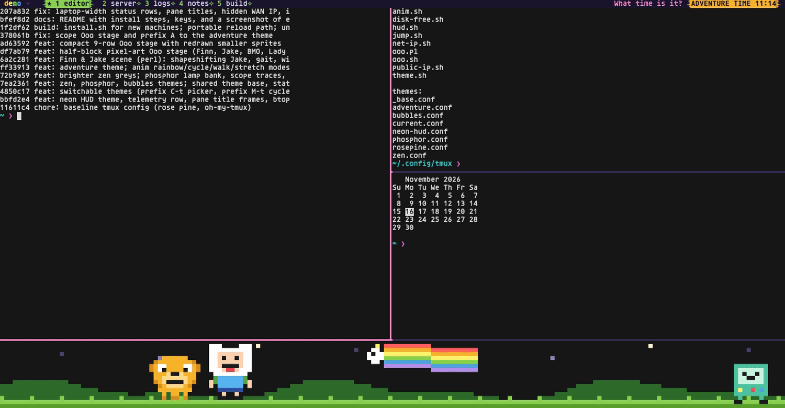
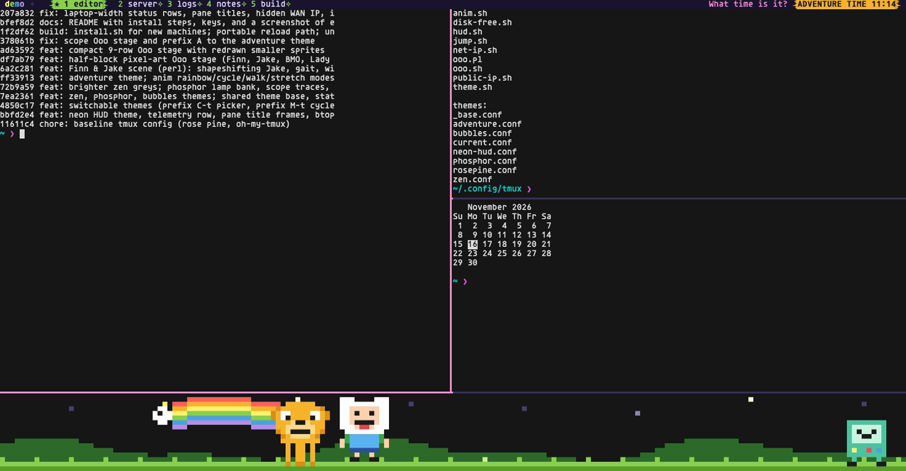
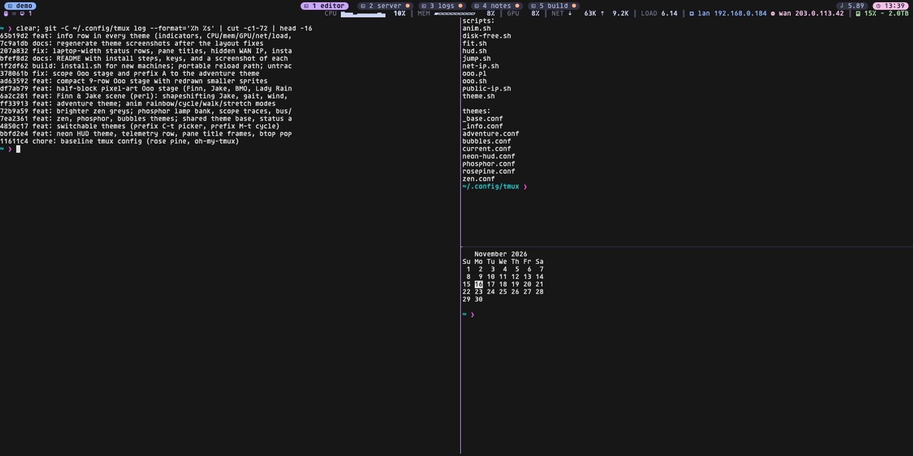
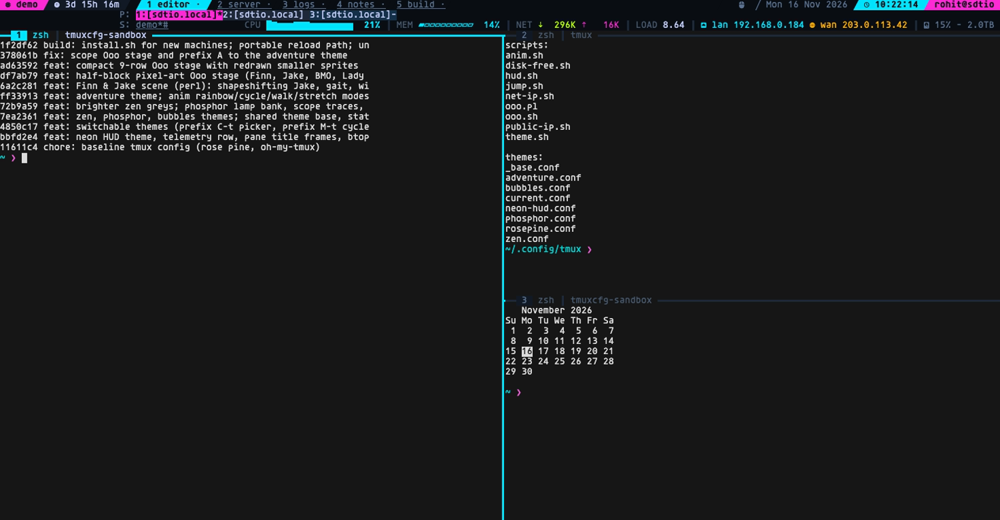
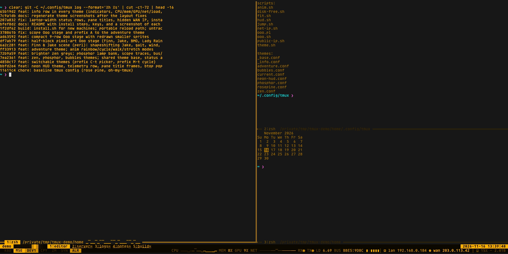
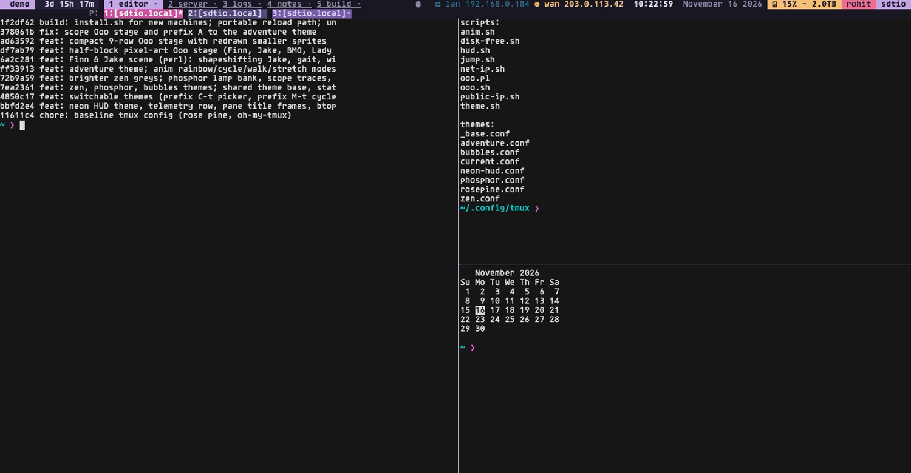

# tmux-config

My tmux setup: [oh-my-tmux](https://github.com/gpakosz/.tmux) as the base, six switchable themes, a live info row in every theme, animations, and a pixel-art Adventure Time stage.



## Info row

Each theme has an info row, in the colours of the theme:

- **Indicators:** mouse mode, keyboard (comes on when you push the prefix), devices (the number of clients attached to the session), synchronized panes.
- **System:** CPU, memory, GPU, network speed (down and up) and load average.
- **IP addresses:** LAN and Wi-Fi (private) and WAN (public).
- **Disk:** free space.

If your terminal is 220 columns or wider, all of this is on one row. If it is narrower, it uses two rows, so nothing is cut off. When you resize the terminal across 220 columns, the layout changes automatically.

## Install (macOS)

```sh
git clone https://github.com/caretak3r/tmux-config ~/.config/tmux
~/.config/tmux/install.sh
tmux
```

`install.sh` does these steps:

1. Installs `tmux`, `fzf`, `btop`, `git` and the Agave Nerd Font with Homebrew.
2. Clones oh-my-tmux to `~/.local/share/tmux/oh-my-tmux` at the tested commit and links `~/.config/tmux/tmux.conf` to it.
3. Moves an old `~/.tmux.conf` to `~/.tmux.conf.bak-<date>`. tmux reads that file first, so it would hide this config.
4. Selects the theme. The first install uses `adventure`. To select a different one, set `TMUX_THEME`, for example `TMUX_THEME=zen ./install.sh`. A second run keeps the current theme unless you set `TMUX_THEME`. The script checks the name before it changes anything.

The first `tmux` start installs [tpm](https://github.com/tmux-plugins/tpm) and the plugins.

Set your terminal font to **Agave Nerd Font** (or a different Nerd Font). The themes use Nerd Font icons and true colour.

Use `SKIP_BREW=1 ./install.sh` if you install the packages yourself.

## Keys

The prefix is `C-a`.

| Keys | Action |
|---|---|
| `C-a C-t` | Theme picker. Push `1`–`6`. `●` shows the active theme. |
| `C-a M-t` | Go to the next theme. |
| `C-a W` | Jump to a window in any session (fzf, with a live preview). |
| `C-a B` | btop in a popup. |
| `C-a A` | Open or close the Adventure Time stage (`adventure` theme only). |
| `C-a Y` | Synchronize the panes in the window. |
| `C-a r` | Reload the config. |
| `C-a m` | Turn the mouse on or off. |
| `C-a N` | Show or hide your public IP address. |

The public IP address is shown by default. Push `C-a N` to hide it, for example when you share your screen. To hide it after every start, add `set -g @show-wan-ip off` to `tmux.conf.local`.

The oh-my-tmux keys also apply. Refer to its [README](https://github.com/gpakosz/.tmux#bindings).

## Themes

### adventure

The Land of Ooo. Each window tab has a different candy colour. The session name shows a moving rainbow, and the catchphrases change every 6 seconds. `C-a A` opens a 9-row stage where Finn and Jake walk over the hills, BMO watches, and Lady Rainicorn flies past.



### bubbles

Catppuccin Mocha. Rounded tabs, one icon for each program in a window, and a load spinner.



### neon-hud

Cyan and magenta on black, with a CPU sparkline, a memory gauge and heat colours on the info row. The second status row lists the panes. Each pane has a title bar.



### phosphor

An amber CRT. The first status row has a KITT scanner, the windows and the clock. The info row has lamps that come on for keyboard, mouse, copy mode, zoom, sync and alerts, a devices count, CPU and network traces that fade like phosphor, a hex bus readout and binary seconds. The active pane border has a moving square wave.



### rosepine

The original Rosé Pine setup. The second status row lists the panes.



### zen

A quiet row at the bottom, Kanagawa colours, and dimmed inactive panes. The info row uses the same muted colours.


## Layout

```
tmux.conf.local      oh-my-tmux settings, keys, plugins; loads the active theme
themes/_base.conf    resets layout options before each theme; shared icons and info-row defaults
themes/<name>.conf   one file per theme
themes/_info.conf    the info row(s), added below the rows of the active theme
themes/current.conf  link to the active theme (machine-local, not in git)
scripts/theme.sh     theme picker and switcher
scripts/hud.sh       CPU, memory, GPU, network and load for the info row (neon, signal or any palette)
scripts/fit.sh       reloads the config when the window crosses 220 columns
scripts/anim.sh      status-bar animations (scan, pulse, spin, train, rainbow, cycle)
scripts/ooo.pl       Adventure Time pixel-art stage (8 fps, half-block pixels)
scripts/ooo.sh       opens and closes the stage
scripts/jump.sh      fzf window jumper
```

To add a theme, copy a file in `themes/` to `themes/<name>.conf` and change it. The picker finds it automatically.

## Plugins

[tmux-resurrect](https://github.com/tmux-plugins/tmux-resurrect), [tmux-continuum](https://github.com/tmux-plugins/tmux-continuum) (saves every 15 minutes and restores on start), [tmux-fzf](https://github.com/sainnhe/tmux-fzf), [extrakto](https://github.com/laktak/extrakto) and [vim-tmux-navigator](https://github.com/christoomey/vim-tmux-navigator).

## Limits

- macOS only. `hud.sh` and `net-ip.sh` use macOS commands (`sysctl`, `netstat -ibn`, `ioreg`, `ipconfig`, `networksetup`).
- tmux re-runs status-bar scripts at most one time each second. Thus status-bar animations move at 1 fps. The Adventure Time stage is a pane, so it moves at 8 fps.
- `C-a M-t` works only if your terminal sends Option as Meta.
