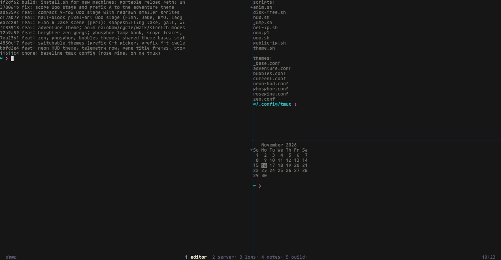

# tmux-config

My tmux setup: [oh-my-tmux](https://github.com/gpakosz/.tmux) as the base, six switchable themes, live status-bar telemetry, animations, and a pixel-art Adventure Time stage.


## Install (macOS)

```sh
git clone https://github.com/caretak3r/tmux-config ~/.config/tmux
~/.config/tmux/install.sh
tmux
```

`install.sh` does these steps:

1. Installs `tmux`, `fzf`, `btop`, `git` and the Agave Nerd Font with Homebrew.
2. Clones oh-my-tmux to `~/.local/share/tmux/oh-my-tmux` at the tested commit and links `~/.config/tmux/tmux.conf` to it.
3. Moves an old `~/.tmux.conf` to `~/.tmux.conf.bak-<date>`. tmux reads that file first, so it would hide this config.
4. Selects the first theme (`adventure`). To select a different one, set `TMUX_THEME`, for example `TMUX_THEME=zen ./install.sh`.

The first `tmux` start installs [tpm](https://github.com/tmux-plugins/tpm) and the plugins.

Set your terminal font to **Agave Nerd Font** (or a different Nerd Font). The themes use Nerd Font icons and true colour.

Use `SKIP_BREW=1 ./install.sh` if you install the packages yourself.

## Keys

The prefix is `C-a`.

| Keys | Action |
|---|---|
| `C-a C-t` | Theme picker. Push `1`–`6`. `●` shows the active theme. |
| `C-a M-t` | Go to the next theme. |
| `C-a W` | Jump to a window in any session (fzf, with a live preview). |
| `C-a B` | btop in a popup. |
| `C-a A` | Open or close the Adventure Time stage (`adventure` theme only). |
| `C-a Y` | Synchronize the panes in the window. |
| `C-a r` | Reload the config. |
| `C-a m` | Turn the mouse on or off. |

The oh-my-tmux keys also apply. Refer to its [README](https://github.com/gpakosz/.tmux#bindings).

## Themes

### adventure

The Land of Ooo. Each window tab has a different candy colour. The session name shows a moving rainbow, and the catchphrases change every 6 seconds. `C-a A` opens a 9-row stage where Finn and Jake walk over the hills, BMO watches, and Lady Rainicorn flies past.


### bubbles

Catppuccin Mocha. Rounded tabs, one icon for each program in a window, and a load spinner.


### neon-hud

Cyan and magenta on black. A third status row shows a CPU sparkline, a memory gauge, network speed, the load average, IP addresses and free disk space. Each pane has a title bar.


### phosphor

An amber CRT. It has a KITT scanner and lamps that come on for prefix, copy mode, zoom, sync and alerts. It also shows CPU and network traces that fade like phosphor, a hex bus readout, binary seconds, and a moving square wave on the active pane border.


### rosepine

The original Rosé Pine setup.


### zen

One quiet row at the bottom, Kanagawa colours, and dimmed inactive panes.



## Layout

```
tmux.conf.local      oh-my-tmux settings, keys, plugins; loads the active theme
themes/_base.conf    resets layout options before each theme; shared icons
themes/<name>.conf   one file per theme
themes/current.conf  link to the active theme (machine-local, not in git)
scripts/theme.sh     theme picker and switcher
scripts/hud.sh       CPU, memory and network data for neon-hud and phosphor
scripts/anim.sh      status-bar animations (scan, pulse, spin, train, rainbow, cycle)
scripts/ooo.pl       Adventure Time pixel-art stage (8 fps, half-block pixels)
scripts/ooo.sh       opens and closes the stage
scripts/jump.sh      fzf window jumper
```

To add a theme, copy a file in `themes/` to `themes/<name>.conf` and change it. The picker finds it automatically.

## Plugins

[tmux-resurrect](https://github.com/tmux-plugins/tmux-resurrect), [tmux-continuum](https://github.com/tmux-plugins/tmux-continuum) (saves every 15 minutes and restores on start), [tmux-fzf](https://github.com/sainnhe/tmux-fzf), [extrakto](https://github.com/laktak/extrakto) and [vim-tmux-navigator](https://github.com/christoomey/vim-tmux-navigator).

## Limits

- macOS only. `hud.sh` and `net-ip.sh` use macOS commands (`sysctl`, `netstat -ibn`, `ipconfig`, `networksetup`).
- tmux re-runs status-bar scripts at most one time each second. Thus status-bar animations move at 1 fps. The Adventure Time stage is a pane, so it moves at 8 fps.
- `C-a M-t` works only if your terminal sends Option as Meta.
